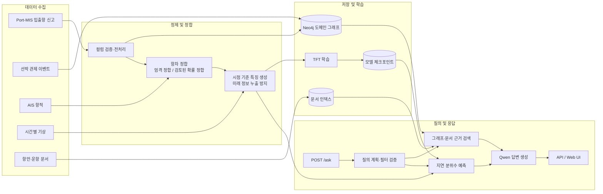

# A Graph RAG-Based AI System for Causal Tracing and Prediction of Vessel Delays

항만 입출항 신고, 선박 관제, AIS, 기상 및 문서 데이터를 결합해 선박 지연의
근거를 추적하고 출항 지연을 예측하는 Graph RAG 기반 AI 시스템입니다.

이 프로젝트는 다음 결과를 하나의 질의 흐름으로 제공합니다.

- Port-MIS 데이터를 기반으로 한 선박·항차·항만·선석 지식 그래프
- 선박 관제 이력, AIS 항적 및 기상 관측을 연결한 근거 데이터
- Neo4j 그래프와 문서 검색 결과를 함께 사용하는 근거 기반 답변
- TFT 모델의 P10/P50/P90 출항 지연 예측
- 검색 근거, 예측값 및 경고를 포함하는 API와 Web UI

> 관제 이벤트나 기상 관측과 지연의 동시 발생은 인과관계의 증거가 될 수 있지만,
> 그 자체로 원인을 확정하지 않습니다. 시스템은 원본 레코드와 검색 근거를 함께
> 제공해 사용자가 결과를 검증할 수 있도록 설계했습니다.

## 기반 기술

- [LightRAG](https://github.com/HKUDS/LightRAG)
- [Temporal Fusion Transformer](https://arxiv.org/abs/1912.09363)

## 전체 워크플로우



### 처리 단계

1. `collect_port_calls.py`로 Port-MIS 입출항 신고를 수집합니다.
2. `collect_vessel_control.py`, `collect_ais_to_csv.py`,
   `collect_weather.py`로 관제·AIS·기상 데이터를 수집합니다.
3. `preprocess_port_calls.py`가 그래프 및 항차 정합에 필요한 컬럼을 검증하고
   선택합니다.
4. `middleware.voyage_matching`이 검증된 식별자로 AIS와 항차를 엄격하게
   연결합니다. 확률 정합 결과는 검토 없이 학습 라벨로 사용하지 않습니다.
5. Port-MIS, 관제 및 기상 레코드를 Neo4j 도메인 그래프에 적재합니다.
6. 항만 문서는 별도의 문서 인덱스에 적재합니다.
7. `middleware.tft_features`가 예측 시점 이전에 관측된 AIS·기상·항차 정보만
   사용해 학습 데이터와 추론 번들을 생성합니다.
8. `middleware.train_tft`가 지연 시간의 P10/P50/P90 분위수를 예측하는 모델을
   학습하고 체크포인트를 저장합니다.
9. `/ask`가 질의를 구조화하고 Neo4j, 문서 검색 및 TFT 예측 결과를 모은 뒤
   Qwen을 통해 근거가 표시된 답변을 생성합니다.

## 주요 디렉터리

| 경로 | 역할 |
|---|---|
| `middleware/` | 그래프 적재, 검색, 항차 정합, 특징 생성, TFT 학습·추론, 질의 API |
| `lightrag/api/routers/portmis_routes.py` | Web UI와 미들웨어를 연결하는 인증 API |
| `lightrag_webui/src/features/` | AIS 지도 및 Port-MIS 대시보드 |
| `scripts/` | 실행 및 CI 보조 스크립트 |
| `tests/collectors/` | 데이터 수집기 테스트 |
| `tests/middleware/` | 그래프·검색·정합·예측 파이프라인 테스트 |
| `data/` | 로컬 원천·가공 데이터; Git에서 제외 |
| `models/` | 학습된 모델 체크포인트; Git에서 제외 |

## 요구 사항

### 실행 환경

- Python 3.10 이상
- Neo4j 5 이상
- Ollama와 `qwen2.5:7b-instruct` 또는 호환 모델
- 선택 사항: Docker/Podman, Web UI 빌드용 Bun

### Python requirements

| 파일 | 용도 | 주요 패키지 |
|---|---|---|
| `pyproject.toml`, `uv.lock` | API 및 프로젝트 기본 환경 | 프로젝트 코어, API, 테스트 extras |
| `middleware/requirements.txt` | 그래프·질의·서비스 실행 | FastAPI, HTTPX, Neo4j, Pydantic, python-dotenv, Uvicorn, WebSockets, tzdata |
| `middleware/requirements-tft.txt` | TFT 학습 및 실제 추론 | 위 미들웨어 requirements, Lightning, pandas, PyTorch Forecasting |

`middleware/requirements.txt`에 적용된 버전 범위는 다음과 같습니다.

```text
fastapi>=0.115,<1.0
httpx>=0.27,<1.0
neo4j>=5.0.0,<7.0.0
pydantic>=2.0,<3.0
python-dotenv>=1.0,<2.0
tzdata>=2024.1
uvicorn>=0.30,<1.0
websockets>=12.0,<17.0
```

TFT 환경은 위 패키지에 다음 항목을 추가합니다.

```text
lightning>=2.2,<3.0
pandas>=2.0,<3.0
pytorch-forecasting>=1.4,<2.0
```

## 설치

저장소 루트에서 실행합니다.

```powershell
python -m venv .venv
.\.venv\Scripts\Activate.ps1
python -m pip install --upgrade pip
python -m pip install -e ".[api,pytest]"
python -m pip install -r middleware\requirements.txt
```

TFT 모델을 학습하거나 실제 체크포인트로 추론할 환경에는 다음을 추가합니다.

```powershell
python -m pip install -r middleware\requirements-tft.txt
```

환경 변수 예시를 복사한 뒤 실제 값으로 수정합니다.

```powershell
Copy-Item middleware\.env.example middleware\.env
```

주요 설정값은 다음과 같습니다.

```dotenv
NEO4J_URI=bolt://localhost:7687
NEO4J_USERNAME=neo4j
NEO4J_PASSWORD=
NEO4J_DATABASE=neo4j
SOURCE_TIMEZONE=Asia/Seoul

OLLAMA_URL=http://localhost:11434
QWEN_MODEL=qwen2.5:7b-instruct
LIGHTRAG_URL=http://localhost:9621

MIDDLEWARE_HOST=127.0.0.1
MIDDLEWARE_PORT=9622

TFT_URL=http://localhost:9623
TFT_CHECKPOINT=models/departure-delay.ckpt
TFT_FEATURES_PATH=data/tft/features.json
TFT_MODEL_VERSION=departure-delay-v1
```

API 키와 비밀번호가 포함된 `.env` 파일은 커밋하지 않습니다.

## 데이터 파이프라인 실행

아래 경로와 항만 코드는 데이터 범위에 맞게 변경합니다.

### 1. 데이터 수집 및 전처리

```powershell
python collect_port_calls.py --port <PORT_CODE> --start 2026-08-01 --end 2026-08-31
python collect_vessel_control.py --port <PORT_CODE> --start 2026-08-01 --end 2026-08-31
python collect_ais_to_csv.py --region korea --output data\ais\korea_ais_stream.csv

python preprocess_port_calls.py `
  --input data\port_calls\port_calls_<PORT_CODE>_20260801_20260831_I.csv

python collect_weather.py `
  --csv data\port_calls\processed\port_calls_<PORT_CODE>_20260801_20260831_I_selected.csv
```

수집기별 인증 정보와 상세 옵션은 다음 문서를 참고합니다.

- [Port-MIS 입출항 수집](docs/PortCallCollector.md)
- [선박 관제 수집](docs/VesselControlCollector.md)
- [기상 데이터셋](middleware/WeatherDataset.md)

### 2. AIS-항차 정합

```powershell
python -m middleware.voyage_matching `
  --ais data\ais\korea_ais_stream.csv `
  --portmis data\port_calls\port_calls_<PORT_CODE>_20260801_20260831_I.csv `
  --output data\voyages\ais_portmis_matches.csv `
  --report data\voyages\voyage_matching_report.json `
  --overwrite
```

확률 정합은 진단 및 수동 검토용입니다. 검토가 끝난 행만 명시적인 옵션을 통해
특징 데이터에 포함해야 합니다.

### 3. Neo4j 그래프 적재

쓰기 전에 `--dry-run`으로 입력과 파생 필드를 검증합니다.

```powershell
python -m middleware.main `
  --csv data\port_calls\processed\port_calls_<PORT_CODE>_20260801_20260831_I_selected.csv `
  --dry-run

python -m middleware.main `
  --csv data\port_calls\processed\port_calls_<PORT_CODE>_20260801_20260831_I_selected.csv

python -m middleware.import_control `
  --csv data\vessel_control\vessel_control_<PORT_CODE>_20260801_20260831.csv

python -m middleware.import_weather
```

그래프 스키마와 적재 규칙은 [middleware/README.md](middleware/README.md)에
정리되어 있습니다.

### 4. TFT 학습 데이터 및 체크포인트 생성

```powershell
python -m middleware.tft_features dataset `
  --portmis data\port_calls\port_calls_<PORT_CODE>_20260801_20260831_I.csv `
  --matches data\voyages\ais_portmis_matches.csv `
  --weather data\weather\weather_hourly.csv `
  --require-weather `
  --output data\tft\training.csv `
  --overwrite

python -m middleware.train_tft `
  --input data\tft\training.csv `
  --output models\departure-delay.ckpt `
  --encoder-length 48
```

실시간 추론용 특징 번들은 반드시 시간대가 포함된 `--as-of` 시점으로 생성합니다.

```powershell
python -m middleware.tft_features bundle `
  --portmis data\port_calls\port_calls_current.csv `
  --matches data\voyages\ais_portmis_matches_current.csv `
  --weather data\weather\weather_hourly.csv `
  --require-weather `
  --as-of 2026-10-29T12:00:00+09:00 `
  --model-version departure-delay-v1 `
  --encoder-length 48 `
  --output data\tft\features.json `
  --overwrite
```

## 서비스 실행

Neo4j와 Ollama를 먼저 실행한 뒤 각 서비스를 별도 터미널에서 시작합니다.

```powershell
# 문서 검색 및 Web UI: 기본 포트 9621
lightrag-server

# 지연 예측 API: 기본 포트 9623
python -m middleware.tft_api

# 통합 질의 API: 기본 포트 9622
python -m middleware.query_api
```

통합 API 문서는 <http://localhost:9622/docs>에서 확인할 수 있습니다.

```json
{
  "question": "2026-10-29 출항 지연을 예측해줘",
  "plan": {
    "intent": "delay_forecast",
    "call_sign": "CALL_SIGN",
    "start_date": "2026-10-29",
    "end_date": "2026-10-29"
  },
  "forecast_steps": 1,
  "use_documents": true
}
```

질의 모드와 응답 스키마는 [middleware/QueryAPI.md](middleware/QueryAPI.md),
특징 및 체크포인트 계약은 [middleware/TFTForecast.md](middleware/TFTForecast.md)를
참고합니다.

## 테스트와 코드 품질

```powershell
pre-commit run --all-files --show-diff-on-failure
pytest tests\ -m offline -v --tb=short
```

GitHub Actions는 Python 3.12와 3.14의 Offline Unit Tests, 포맷·Lint 검사 및
PostgreSQL smoke test를 실행합니다.

## Git에 포함하지 않는 파일

다음 항목은 로컬 또는 실행 환경에서 관리하며 저장소에 커밋하지 않습니다.

- `.env`와 API 키·DB 비밀번호
- `data/`의 원천 및 가공 데이터
- `models/`의 학습 체크포인트
- 로그, 캐시, 평가 결과 및 런타임 저장소

Git에는 소스 코드, 스키마, 예제 설정, 문서와 재현 가능한 테스트 fixture만
포함합니다.

## License

이 저장소의 라이선스는 [LICENSE](LICENSE)를 참고합니다.
