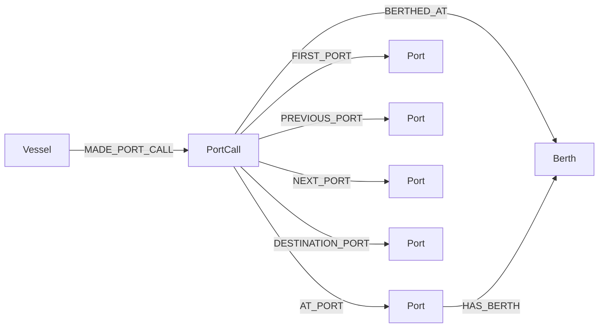

# Port-MIS Neo4j middleware

For the new **Neo4j → Qwen answer API with LightRAG document context**, see
[Query API instructions](QueryAPI.md). Start it separately with
`python -m middleware.query_api` and open `http://localhost:9622/docs`.

This package turns Port-MIS CSV records into a typed knowledge graph, with
deterministic entity keys and batch transactions. It runs within the existing
LightRAG repository and reuses the 32-column contract in
`preprocess_port_calls.py`. It does not change the collector or selected CSV.
The standard-library CSV reader streams records instead of using pandas,
preserving leading zeros and bounding payload memory to a batch. Exact unique
entity counts still require memory proportional to distinct identifiers.

## Install and configure

Python 3.10+ and Neo4j 5+ are required. From `LightRAG`:

```powershell
python -m pip install -r middleware/requirements.txt
Copy-Item middleware/.env.example middleware/.env
```

Fill in `middleware/.env`:

```dotenv
NEO4J_URI=bolt://localhost:7687
NEO4J_USERNAME=neo4j
NEO4J_PASSWORD=your_database_password
NEO4J_DATABASE=neo4j
CSV_PATH=data/port_calls/processed/port_calls_020_20260801_20260831_I_selected.csv
BATCH_SIZE=1000
DELAY_THRESHOLD_MINUTES=60
SOURCE_TIMEZONE=Asia/Seoul
```

The default dotenv is `middleware/.env`, not LightRAG's `.env`. Use
`--env-file .env` explicitly to reuse that file. Existing environment variables
override dotenv; CLI CSV and batch size override both. Relative CSV paths are
relative to the terminal working directory. A service/API key is not needed.

Run a local Neo4j using Docker Desktop. Set `NEO4J_PASSWORD` in the current
PowerShell session to the same password as your middleware dotenv, then:

```powershell
docker run -d --name portmis-neo4j -p 127.0.0.1:7474:7474 -p 127.0.0.1:7687:7687 -e "NEO4J_AUTH=neo4j/$env:NEO4J_PASSWORD" -v portmis-neo4j-data:/data neo4j:5-community
```

Use a nonempty password accepted by Neo4j. Reuse an existing Neo4j instance
instead of running this command if one already occupies those ports. Open
<http://localhost:7474> for Browser. Stop with `docker stop portmis-neo4j`;
restart with `docker start portmis-neo4j`. The named volume keeps database data.

## Run

```powershell
python -m middleware.main --csv data/port_calls/processed/port_calls_020_20260801_20260831_I_selected.csv --dry-run
python -m middleware.main --csv data/port_calls/processed/port_calls_020_20260801_20260831_I_selected.csv --dry-run --limit 100
python -m middleware.main --csv data/port_calls/processed/port_calls_020_20260801_20260831_I_selected.csv --batch-size 1000
```

Dry-run uses the identical transformations and reports entity counts, field
errors, available derived features, input/valid/skipped rows and planned batches.
It does not import/connect to the Neo4j driver or require DB credentials.
`--limit` limits input rows, including skipped rows; zero checks only headers.
Counts describe the input, not how many objects already exist in the DB.

## Graph schema and properties



| Label | Properties |
|---|---|
| Vessel | `vesselKey`, `callSign`, `name`, `nationalityCode`, `vesselTypeCode`, `vesselTypeName`, `grossTonnage` |
| PortCall | `recordId`, `purpose`, `arrivalTime`, `departureTime`, `plannedDepartureTime`, `destinationEta`, `tugUsed`, `pilotageUsed`, `cargoCode`, `loadedTon`, `transshipmentTon`, `unloadedCargoTon`, `loadedCargoTon`, `portStayMinutes`, `departureScheduleDeviationMinutes`, `departureDelayMinutes`, `isDepartureDelayed`, `cargoOperationTon`, `sourceFile`, `sourceRow`, `sourceTimezone`, `delayThresholdMinutes` |
| Port | `portKey`, `code`, `name`, `codeScheme` |
| Berth | `berthKey`, `code`, `subCode`, `name` |

The native datetime properties are created through parameterized Cypher
`datetime()`. Naive values use `SOURCE_TIMEZONE`; explicit offsets are retained.
Ambiguous/nonexistent DST local times become null with warnings. Null Neo4j
properties are absent (and evaluate to null when queried).

Unique constraints (and backing indexes) are created with `IF NOT EXISTS` on:

- `Vessel.vesselKey`: normalized call sign, else normalized vessel name.
- `PortCall.recordId`: source record hash, one declaration **row** per event.
- `Port.portKey`: code scheme + code, else scheme + normalized name.
- `Berth.berthKey`: current port key + facility code (else name) + subcode.

Composite keys use escaped JSON tuples to avoid delimiter collisions. The
current port's authority code (e.g. `020`) is not equated with route port codes
(e.g. `KRPUS`). These share the `Port` label but are separate identities until a
verified crosswalk is supplied. A facility without a current port is skipped
with a warning. Empty route fields create no port or relationship.

`MERGE` and constraints prevent duplicate nodes for identical keys. All eight
relationship types use `MERGE`. Vessel/Port/Berth descriptive attributes use
first-seen values (`ON CREATE SET`) to avoid treating CSV order as chronology;
they are not authoritative latest values. PortCall properties are refreshed
on reimport, including derived features when configuration changes. Input
`record_id` is assumed immutable and trustworthy: do not reuse it for a changed
declaration. Conflicting reused IDs are not reconciled. Earlier descriptions
are not overwritten by later missing values on shared entities.

## Derived features

- `portStayMinutes`: departure minus arrival in minutes; missing endpoints or
  negative result -> null (negative durations produce warnings).
- `departureScheduleDeviationMinutes`: actual minus planned departure; negative
  deviations are retained.
- `departureDelayMinutes`: `max(0, deviation)`; unknown deviation -> null.
- `isDepartureDelayed`: delay >= configured threshold; unknown delay -> null.
- `cargoOperationTon`: unloading + loading + transshipment; missing operands
  contribute zero. `loadedTon` is not included, and original missing operands
  stay null. All missing operands therefore produce a derived zero, not evidence
  that no cargo operation occurred.

Invalid numbers, Y/N and dates become null with diagnostics. Null sentinels
include empty, `null`, `None`, `NaN`, NaT and pandas NA string representations.
Invalid fields do not skip a row; missing record ID or both vessel identifiers
does. Headers must contain all 32 selected columns (extra columns are allowed).
Malformed CSV records are skipped; unrecoverable parser errors stop the run.

## Example queries

Set `$vesselName` in Browser, e.g. `:param vesselName => '36한진호'`.

```cypher
MATCH (v:Vessel)-[:MADE_PORT_CALL]->(pc:PortCall)
WHERE v.name = $vesselName
RETURN v, pc ORDER BY pc.arrivalTime;
```

```cypher
MATCH (v:Vessel)-[:MADE_PORT_CALL]->(pc:PortCall)
WHERE pc.isDepartureDelayed = true
RETURN v.name, pc.departureDelayMinutes
ORDER BY pc.departureDelayMinutes DESC;
```

```cypher
MATCH (prev:Port)<-[:PREVIOUS_PORT]-(pc:PortCall)-[:AT_PORT]->(current:Port)
OPTIONAL MATCH (pc)-[:NEXT_PORT]->(next:Port)
RETURN prev.name, current.name, next.name;
```

```cypher
MATCH (pc:PortCall)-[:BERTHED_AT]->(b:Berth)
RETURN b.name, count(pc) AS portCallCount ORDER BY portCallCount DESC;
```

```cypher
MATCH (v:Vessel)-[:MADE_PORT_CALL]->(pc:PortCall)
RETURN v.name, pc.cargoOperationTon, pc.portStayMinutes,
       pc.departureDelayMinutes LIMIT 100;
```

## Error boundaries and tests

Every batch's node and relationship queries share a managed transaction. A
failed batch rolls back; previous batches remain committed. Re-running the
same immutable input is safe. Logs identify failed batch, source-row range and
first/last record IDs, but do not dump driver errors or passwords. If a batch
fails, narrow it with a small input slice to identify an individual record;
the middleware does not retry bad records independently after partial writes.

```powershell
python -m pip install pytest
python -m pytest -c tests/middleware/pytest.ini tests/middleware --confcutdir=tests/middleware -q
```

For an opt-in integration test, set `PORTMIS_TEST_NEO4J_URI` and
`PORTMIS_TEST_NEO4J_PASSWORD` to a dedicated test database. The test creates
uniqueness constraints, writes UUID-scoped fixture entities, verifies reimport
and native datetime behavior, tests rollback, and deletes only its fixture
entities. It leaves constraints in place. The default suite skips this test.

## Limits and extension points

Validation on 2026-09-13: 27 tests passed with a temporary Neo4j 5 Community
instance, including reimport, datetime and rollback checks. Ruff passed.
The temporary database was removed after testing. A full CSV dry-run processed
6,880 rows in 7 batches with 1,623 unique Vessel keys, 6,880 PortCall keys,
452 Port keys and 177 Berth keys. Both stay and delay availability were zero.
No production graph was modified.

The existing selected CSV has 6,880 declaration rows, not 6,880 distinct physical
visits. Under the requested row-event schema, arrival and departure rows stay
separate. This particular file has no rows containing both endpoints needed
for stay or departure-delay calculation, so those features are null. Pairing
requires a later step using validated visit identifiers from the original CSV
(`etryptYear`, `etryptCo`, authority and call sign); do not pair by name alone.
Future dates or implausible years are parseable, not automatically corrected.
This importer does not prove actual voyage completion or delay causality.

This is a domain graph, **not LightRAG's internal graph storage schema**.
Changing `LIGHTRAG_GRAPH_STORAGE` alone does not make it searchable. The separate
[query API](QueryAPI.md) now supplies read-only Cypher retrieval, Qwen answers
and optional LightRAG document context. An adapter to `ainsert_custom_kg()`
or graph-description embedding remains optional future work. Qwen is not used
to infer structured fields or causes in this importer.

For AIS/MMSI/IMO matching, extend `utils.vessel_key` via verified identifier
crosswalks (do not equate call sign and MMSI). Link `AISObservation` to Vessel;
align WeatherObservation with port/location and event time; add DelayEvent only
when its metric is known. Add CongestionEvent and evidence-backed `CAUSED_BY`
links separately. `graph_schema.py`, preprocessing maps and the batch writer
are the places to register new entity and relationship mappings.

References: [official managed transactions](https://neo4j.com/docs/python-manual/current/transactions/),
[official unique constraints](https://neo4j.com/docs/cypher-manual/current/schema/constraints/create-constraints/).
